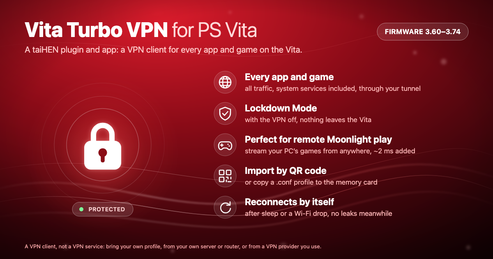
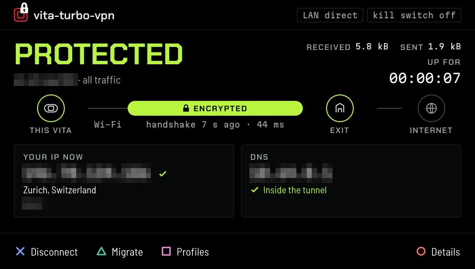
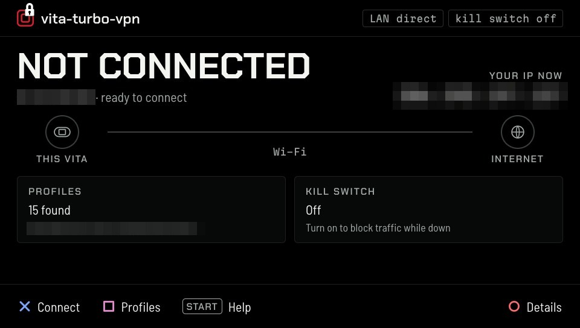
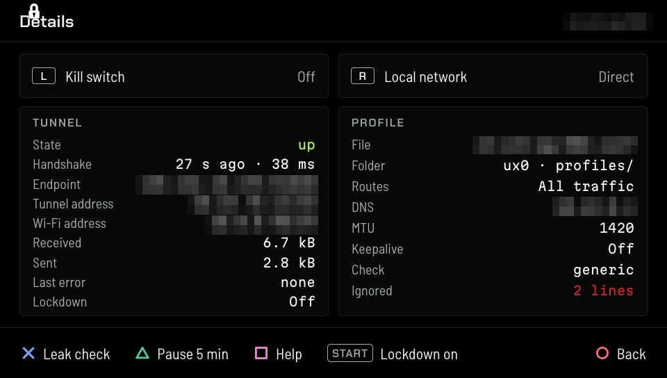
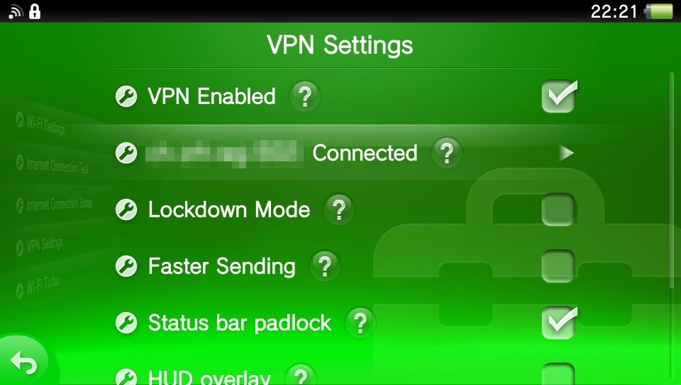

<div align="center">

# 🔒 Vita Turbo VPN for PS Vita

**A VPN for the whole Vita: every app and every game, through your own tunnel server.**

A taiHEN plugin (kernel module + Settings and quick-menu pages) and a LiveArea app,
for HENkaku/Ensō on firmware 3.60 to 3.74.



</div>

> [!NOTE]
> **This is a VPN client, not a VPN service.** It gives you no servers,
> accounts, traffic or free VPN of its own. It connects your Vita to a tunnel
> server you already have: your own home server or router, or a VPN provider
> you pay for separately. You bring the profile (a `.conf` file or its QR
> code); nothing is included or sold here. **Without a profile, this does
> nothing.**

> [!IMPORTANT]
> **Early release.** Built for firmware **3.60 to 3.74**, but so far tested
> on one console: a PS Vita 1000 on firmware 3.60. Treat it as experimental.
> Read the [Disclaimer](#disclaimer), and if something doesn't work, please
> [open an issue](https://github.com/juanjsebgarcia/vita-turbo-vpn/issues)
> with your logs, after replacing your server's address, your public address
> and your profile names with placeholders. Never attach your profile: it
> contains your private key.

---

## Why

The Vita has no VPN of its own, and no app on it can add one: a homebrew app
only sees its own traffic, and the system's own services go around it.

Vita Turbo VPN adds one where it belongs, underneath everything. A kernel
module gives the Vita a second network interface, and the system routes
traffic into it like any other network. So:

- **Everything is covered.** Games, the browser, and all other system
  operations all go through the tunnel. Nothing is special-cased.
- **It's your server, or your provider's.** It reads standard tunnel
  profiles: the `.conf` files that home servers, routers and VPN providers
  export for a modern VPN protocol built on ChaCha20-Poly1305 and Curve25519.
- **Encryption is never the bottleneck.** The cipher runs in hand-tuned NEON
  assembly at about 230 Mbit/s per core, far more than the Vita's Wi-Fi can
  carry.
- **It's built for a handheld.** Switch it on and off without closing your
  game, keep traffic in when the Vita wakes from sleep or the Wi-Fi drops,
  and pause it for a hotel login page.

Use it for privacy on public Wi-Fi, to reach your home network from
anywhere (FTP, media servers, remote play such as Moonlight), or to appear
in another country.

## Headline figures

Measured on a PS Vita 1000 (firmware 3.60) on home Wi-Fi next to the access
point, plain HTTP to a server on the same network, runs alternated; round
trip from 200 pings at 20 ms intervals (the slowest 5% are the Wi-Fi's own
variation, about the same with or without the tunnel).

| | Without the tunnel | Through the tunnel | Change |
|---|---|---|---|
| TCP download | ~30–34 Mbit/s | ~18–21 Mbit/s | about 55–60% of direct |
| Round trip, median | 5.4 ms | 7.5 ms | about +2 ms |
| Tunnel off: download and ping | same as without the module installed | | no measurable cost |
| Back online after a Wi-Fi drop | | hands-free, ~0.1 s after the Wi-Fi reconnects | |
| Packets sent in the clear after waking from sleep | | **0** | |

The encryption itself runs at about 29 MB/s sealing and 26 MB/s opening per
core (about 230 Mbit/s), so the limit is the Wi-Fi link and the extra
per-packet work of the tunnel, not the cipher. Receiving costs about
0.3 ms of CPU per packet (worked out from the per-packet timings), so a
full-speed download through the tunnel uses about half of one core: the
system core, not the ones games use (unless Faster Sending is on, which
moves the sending side there). With the tunnel off it costs nothing
measurable.

## Features

- 🌐 **The whole console, at the network layer.** A real network interface:
  every app, game and system service goes through the tunnel.
- 🏎️ **Native NEON-accelerated encryption.** The tunnel's ChaCha20-Poly1305
  runs in hand-tuned ARM NEON assembly (the CRYPTOGAMS implementation) on the
  Vita's vector unit: about 29 MB/s sealing and 26 MB/s opening per core,
  about 230 Mbit/s, well over twice the portable C code (12 MB/s) and far
  beyond what the Vita's Wi-Fi can carry, so the CPU's crypto is never the
  limit.
- 🔑 **Standard profiles.** Any standard tunnel `.conf` file from a home
  server, router or VPN provider. Full tunnel (everything) or split tunnel
  (only your home network), decided by the profile's `AllowedIPs`.
- 📷 **QR import.** Show the code on a computer screen and scan it with the
  rear camera; the app saves it as a `.conf` file and skips duplicates.
- 🎮 **Switch it without closing your game.** *VPN Enabled* in
  *Settings → Network → VPN Settings*, and in the PS button quick menu.
- 🔍 **Exit IP and location check.** The address, city, country and network
  that websites see, compared with your own.
- 🔎 **DNS leak check, and DNS through the tunnel.** Lookups use the
  profile's DNS servers inside the tunnel; the app checks whether anything
  escapes over Wi-Fi, locally and, optionally, online.
- 🛑 **Kill switch** (optional, off by default). A tunnel that goes down
  holds traffic back instead of falling back to plain Wi-Fi. With it off, the
  app and the quick menu say "Not protected" rather than staying silent.
- 🔐 **Lockdown Mode** (optional). Only tunnel traffic may leave the Vita,
  even while disconnected and after a restart. To get out of it: turn it off
  in the app or in *VPN Settings*, hold **L** at boot, or create the file
  `ur0:data/vpnturbo/lockdown_off`.
- ⏸️ **Pause 5 min.** Tunnel and kill switch off for five minutes, then back
  on by itself: for hotel and café login pages. Not available under
  Lockdown.
- 🏠 **Local network stays reachable** (optional, on by default): FTP to
  your computer, LAN remote play (Moonlight) and other local devices go
  direct.
- 😴 **Nothing leaks when the Vita wakes.** If the tunnel was on when the
  Vita went to sleep, traffic waits for it after wake instead of going out
  over plain Wi-Fi ("Blocked: reconnecting VPN"), until the tunnel is back.
- 📶 **Survives Wi-Fi drops.** If the Wi-Fi goes away, the tunnel waits and
  reconnects by itself when it comes back, and your local network is
  reachable again afterwards.
- ⚡ **Live latency.** The tunnel's round trip in milliseconds, next to the
  handshake age.
- 📊 **Traffic counters.** Received and sent, for as long as the console is
  on.
- 🔒 **Padlock in the centre of the status bar**: white while the tunnel is up, red
  while traffic is held back (see [the padlock](#the-status-bar-padlock)), and an optional
  **HUD** with the tunnel state, tunnel address and exit address.
- 🚀 **Faster Sending** `[EXPERIMENTAL]` (off by default, in *VPN Settings*).
  Runs the send thread on a free game core: lower send latency and a little
  more speed, at the cost of a little game-core time. Changing it restarts
  the console.
- 🛟 **Boot guard.** If two starts in a row fail, the plugin stands down by
  itself; the app then offers *Turn on and restart*.
- 🌍 **In your system language** (20 languages) on every screen, the
  Settings page and the quick menu.

## Use cases

### ☕ Public Wi-Fi
Coffee shops, hotels, trains. Turn on the kill switch (or Lockdown Mode) and
nothing leaves the Vita outside the tunnel. Use *Pause 5 min* for the login
page.

### 🏠 Your home network from anywhere
Point a split-tunnel profile at your home server or router, and FTP, media
servers and remote play such as Moonlight game streaming work from
anywhere as they do at home, while everything else goes direct. The tunnel
adds about 2 ms to the round trip, and Faster Sending can lower the delay
of your controller input further.

### 🌍 Appear in another country
With a full-tunnel profile on a server abroad, websites and online services
see that country's address instead of yours.

## Screenshots

| Connected | Not connected |
|---|---|
|  |  |

| Details | Settings → Network → VPN Settings |
|---|---|
|  |  |

*Profile names and addresses are blurred.*

## Options

### In the app

On the **Details** screen (○ from Home):

| Option | Button | What it does | Default |
|---|---|---|---|
| **Kill switch** | L | While the tunnel is down, hold traffic back instead of going direct over Wi-Fi. Released while paused. | Off |
| **Local network** | R | Reach devices on your own network directly. Off: the local subnet goes into the tunnel too. | On (direct) |
| **Lockdown** | START | Only tunnel traffic may leave, even disconnected and after a restart. Turns Pause off. | Off |

Per profile, one optional line in the `.conf` picks the service that
answers the exit-address check: `# vita-turbo-vpn: check = generic` (the
built-in default) or `# vita-turbo-vpn: check = https://...` (your own
HTTPS service returning the address). The app shows profiles by file name.

### Settings → Network → VPN Settings

| Option | What it does | Default |
|---|---|---|
| **VPN Enabled** | Connects or disconnects the last profile used in the app. | Off after reboot |
| Status line | `<nickname>: <state>`: Connected, Connecting, Not protected, Blocked: reconnecting VPN, Paused. | |
| **Lockdown Mode** | As in the app. | Off |
| **Faster Sending** `[EXPERIMENTAL]` | Send thread on a free game core: lower send latency, a little more speed, a little game-core time. Changing it restarts the console. | Off |
| **VPN HUD overlay** | Tunnel state over the screen: Off, Compact (one line with the state) or Extended (adds the tunnel address and the exit address). | Off |
| **HUD position** | Which corner. | Bottom left |
| **In-game HUD** | Also show the HUD over games and apps. | Off |
| **Status bar padlock** | A padlock in the centre of the status bar (see below). | On |

### The status-bar padlock

The padlock is drawn in the centre of the status bar. It is **white** while
the VPN is connected. It turns **red** whenever traffic is being held back:
either the tunnel's own lockdown (after a wake or a Wi-Fi change, "Blocked:
reconnecting VPN"), or Lockdown Mode is on while the VPN is not connected.
It is not red while the VPN is paused. So if nothing reaches the network and
the padlock is red, Lockdown Mode is on: turn it off in *Settings → Network →
VPN Settings*, or connect. With no padlock, nothing is being held back and
the VPN is not connected (that includes a pause).

### Quick menu (PS button)

| Row | What it does |
|---|---|
| **VPN - VPN** | The same switch, without leaving your game. |
| **Status** | The tunnel's state. |
| **Profile** | The last-used profile's nickname. |
| **VPN - HUD** | Show or hide the HUD. |
| **Pause VPN 5 min** / **Resume VPN** | Pause, or end a pause early. Dimmed while the tunnel is off or under Lockdown. |

### Where profiles go

Copy `.conf` files to `ux0:data/vita-turbo-vpn/profiles/` (the same
`data/.../profiles/` folder also works on `uma0:`, `imc0:` and `ur0:`). The
app lists all of them, showing which storage each is on. One level of
sub-folders and `.zip` files appear as groups. QR imports are saved to
`ux0:data/vita-turbo-vpn/profiles/`.

Supported in a profile: one `[Peer]`, IPv4 addresses, `DNS`,
`AllowedIPs` (full or split), `Endpoint` as an address or a hostname,
`PersistentKeepalive`, `PresharedKey`, `MTU`. Lines the Vita can't use (IPv6
addresses, `PostUp` and other scripts) are ignored and the app tells you
which.

**Your profile contains your private key.** Anyone who can read your memory
card can read it, as on any device with a `.conf` file.

### HTTPS checks and the clock

The exit-address and online DNS checks use HTTPS, verified against a
built-in set of trusted root certificates. To add your own, put an
`extra-ca.pem` file in `ux0:data/vita-turbo-vpn/`. **The
Vita's date must be right**: if it has reset, the checks fail and the app
says so.

## How to use it

**Why an app *and* a Settings page?** The app is where you set things up:
profiles, QR import, the checks and the details. But like any LiveArea app,
it has to be closed before a game can run. So the switch also lives in
*Settings → Network → VPN Settings* and in the PS button's quick menu, which
are always there, even with a game suspended. Closing the app never stops
the tunnel.

1. **Set up in the app.** Open the app, choose or import a profile, connect,
   and check it works (the app shows your exit address and checks DNS).
2. **Leave the app and start your game.** Opening any LiveArea app closes the
   one that is running, so the VPN app isn't meant to stay open: **the tunnel
   keeps running without it.**
3. **Switch it from anywhere with Settings or the quick menu.**
   *Settings → Network → VPN Settings* has **VPN Enabled**, and the PS
   button's quick menu has the same switch plus **Pause VPN 5 min**. Both work
   over a suspended game and use the last profile you connected in the app.
4. **Anything else means going back to the app.** Choosing another profile,
   the checks and the per-profile options live only in the app, which means
   closing the game first.

A reboot always starts with the tunnel off; switch it on again from any of
the three places.

## Compatibility

- **Consoles:** tested on a PS Vita 1000. The PCH-2000 and the PS TV should
  work the same way but are untested: reports welcome.
- **Firmware:** 3.60 to 3.74 (one build for all). Tested on 3.60.
- **Wi-Fi:** yes. **Ethernet** (PS TV, USB adapters): handled the same way
  as Wi-Fi (the module follows whatever the network settings connect), but
  untested.
  **3G: not supported.**
- **Servers:** any server or provider that exports standard tunnel `.conf`
  profiles. Tested with a self-hosted server on the same network and with a
  commercial provider's servers abroad, full tunnel, hostname and IP
  endpoints.
- **Wi-Fi Turbo and Turbo Storage:** compatible: every test ran with both
  installed and active on the same console.

## Limitations

- **IPv4 only**, one server (peer) per profile, client only. The Vita has no
  IPv6.
- **3G is not supported.**
- **No ad hoc play while the tunnel is on.** Ad hoc works below the layer the
  tunnel covers; disconnect or pause to play ad hoc.
- **A reboot starts with the tunnel off**; there is no automatic connect at
  boot (Lockdown Mode, if on, keeps blocking until you connect).
- **The app must be closed to start a game**, as with any LiveArea app: set
  up in the app, then switch from Settings or the quick menu.
- **An app that sets its own DNS servers** bypasses the profile's DNS.
- **No drop notification yet**: a tunnel that drops shows in the quick menu,
  on the Settings page and on the HUD.
- **The status-bar padlock also shows inside the app**, over the top centre
  of its screen, where there is no status bar (cosmetic, known in v0.1.0).
- **Faster Sending is experimental.**
- **Battery cost is not measured yet.** CPU cost: see the figures above.

## Measuring it yourself

- **Round trip:** the app's Home screen shows the tunnel's latency live,
  next to the handshake age.
- **Leaks, from the Vita:** Details → Leak check (✕) shows where your DNS
  lookups go, and Home shows the exit address websites see.
- **Leaks, from a computer:** capture the Vita's traffic on your router or
  access point (for example with a packet capture tool such as
  `tcpdump host <vita-ip>`). With the tunnel up, the only packets to the internet should be UDP to your
  server's address and port; local-network traffic appears only if Local
  network is on. Repeat after putting the Vita to sleep and waking it, and
  after turning its Wi-Fi off and on: nothing else should appear before the
  tunnel is back.

The throughput and round-trip figures above came from a test build with a
built-in downloader and UDP echo client; it is not part of this release.

## Security

- **Native NEON encryption.** The data path's ChaCha20-Poly1305 runs in
  hand-tuned ARM NEON assembly from CRYPTOGAMS, at about 29 MB/s sealing and
  26 MB/s opening per core (about 230 Mbit/s), so strong encryption costs no
  speed you could notice over Wi-Fi.
- **Keys stay put.** Profiles reach the kernel module as a fixed-size
  structure; private and preshared keys are write-only, never read back by
  any app or plugin, and wiped on disconnect.
- **Only known callers.** Only the app, the system shell and the Settings app
  can control the tunnel, and Settings only changes its own switches.
- **Every packet authenticated first.** Nothing looks at a received packet
  before it is authenticated, and its source is checked against the
  profile's `AllowedIPs`.
- **Floods cost time, not memory.** The protocol's cookie mechanism engages
  under load and the handshake queue is bounded.
- **Logs never contain keys or packet contents.** Logs are in
  `ur0:data/vpnturbo/` (`kernel.log`, `shell.log`, `app.log`).
- **Clock-safe.** The last handshake time is remembered per key, so a Vita
  whose clock jumps back is not silently ignored by its server.
- **The protocol core is unmodified.** The handshake and the cryptography
  are OpenBSD's own sources, compiled as published, with their self-tests.
  The data-path cipher (ChaCha20-Poly1305) uses the CRYPTOGAMS ARM and NEON
  assembly instead, under its BSD licence, and is checked byte for byte
  against the portable implementation in the test suite, including on
  misaligned buffers.

## Languages

The app, the Settings page and the quick menu follow your system language.
Supported:

Japanese, English (US), English (UK), French, Spanish, German, Italian, Dutch,
Portuguese (Portugal), Portuguese (Brazil), Russian, Korean,
Chinese (Traditional), Chinese (Simplified), Finnish, Swedish, Danish,
Norwegian, Polish and Turkish.

The HUD uses a compact ASCII font, so it's translated for the Latin-script
languages and shows English for the others.

## Disclaimer

This software is provided **"as is", without warranty of any kind**, express or
implied, including but not limited to the warranties of merchantability,
fitness for a particular purpose and non-infringement. It modifies how system
software on your console behaves. **You use it entirely at your own risk.** The
author is not responsible for any damage, data loss, bricked or unusable
systems, lost warranty, account action, or any other harm resulting from
installing or using it. A VPN does not make you anonymous, and using one may
be against the terms of some services or the law in some places: check
yours. Keep backups, and make sure you know how to boot without plugins (hold
**L** at boot) before you install. See the [LICENSE](LICENSE) for the full
terms.

Vita Turbo VPN is an unofficial project, not affiliated with or endorsed by Sony
Interactive Entertainment. PlayStation and PS Vita are trademarks of
their respective owners.

## Install

**Requirements:** a PS Vita or PS TV with HENkaku or Ensō (taiHEN) on
firmware **3.60 to 3.74**, and your own tunnel server or a VPN provider that
gives you a standard `.conf` file or QR code. **None is included.** The
tunnel uses UDP on the port in your profile (often 51820): if you host the
server yourself, allow that port through your router.

1. Download `vpnturbo_kernel.skprx`, `vpnturbo.suprx`,
   `vpnturbo_settings.suprx` and `vita-turbo-vpn.vpk` from the
   [latest release](https://github.com/juanjsebgarcia/vita-turbo-vpn/releases/latest).
2. Copy the three plugin files to `ur0:tai/`, for example over FTP (VitaShell)
   or USB.
3. **Find your config file.** If `ux0:tai/config.txt` exists, edit **that**
   one: taiHEN reads it first and ignores `ur0:tai/config.txt`. Otherwise
   edit `ur0:tai/config.txt`. Keep the `ur0:tai/...` paths for the plugin
   files either way.

   Add one line under each of three sections:

   | Section | Line to add |
   |---|---|
   | `*KERNEL` | `ur0:tai/vpnturbo_kernel.skprx` |
   | `*main` | `ur0:tai/vpnturbo.suprx` |
   | `*NPXS10015` | `ur0:tai/vpnturbo_settings.suprx` (adds the Settings page) |

   A typical file afterwards looks like this:

   ```
   *KERNEL
   ur0:tai/vpnturbo_kernel.skprx
   *main
   ur0:tai/henkaku.suprx
   ur0:tai/vpnturbo.suprx
   *NPXS10015
   ur0:tai/henkaku.suprx
   ur0:tai/vpnturbo_settings.suprx
   *NPXS10016
   ur0:tai/henkaku.suprx
   ```

4. Install `vita-turbo-vpn.vpk` with your usual VPK installer.
5. Copy your `.conf` files to `ux0:data/vita-turbo-vpn/profiles/`
   (see [Where profiles go](#where-profiles-go)), or import them by QR code
   in the app later.
6. **Reboot the Vita** (a "Refresh taiHEN config" is not enough). Open the
   app: it checks that the kernel module is loaded with the right API
   version and that the SceShell module is listed in `config.txt`, and tells
   you which one is missing if not.
7. *Optional:* the quick menu rows, below.

**To update:** replace the three files (and the quick menu file if you use
it), reinstall the VPK, and reboot. **To uninstall:** turn Lockdown Mode off
if you use it, remove the lines from `config.txt`, reboot, delete the plugin
files and the app, then delete the profiles folder
(`ux0:data/vita-turbo-vpn/profiles/` and its parent) and the log
folder `ur0:data/vpnturbo/`.

**If anything goes wrong:** hold **L** while the Vita boots to skip all
plugins, then remove the lines from `config.txt`.

### Quick menu rows (optional)

Adds the VPN switch, status and Pause to the PS button quick menu. It is a
separate, optional file that needs
[QuickMenuReborn](https://github.com/Ibrahim778/QuickMenuReborn), the
community library other plugins use for their quick-menu rows.

1. Install QuickMenuReborn if you don't have it yet: copy
   `QuickMenuReborn.suprx` to `ur0:tai/` and add it under `*main` in your
   config file, then copy `qmr_plugin.rco` to `ur0:QuickMenuReborn/`.
2. Copy `vpnturbo_qm.suprx` from the release to
   `ux0:QuickMenuReborn/` if that folder exists, otherwise to
   `ur0:QuickMenuReborn/`. It doesn't go in `config.txt`: QuickMenuReborn
   loads it.
3. Reboot, wait a few seconds on the Home screen, then press the PS button.

To remove them, delete `vpnturbo_qm.suprx`.

> Another plugin's uninstaller may remove QuickMenuReborn along with its own
> files; if the rows disappear, reinstall QuickMenuReborn.

## Build

```sh
make                       # uses $VITASDK if set, otherwise a pinned VitaSDK Docker image
make app                   # the LiveArea app (VPK)
make deploy VITA_IP=<vita> # upload the modules and reboot
make log    VITA_IP=<vita> # fetch the logs
make config                # print the config.txt lines
```

Output: `build/kernel/vpnturbo_kernel.skprx`, `build/vpnturbo.suprx`,
`build/vpnturbo_settings.suprx`, `build/vpnturbo_qm.suprx` and
`app/build-release/vpnturbo.vpk` (published as `vita-turbo-vpn.vpk`). The
SceShell module and the Settings page are separate modules, as in Wi-Fi
Turbo, so SceShell holds none of the page's code or strings.

## Safety

- **Easy undo.** Disconnect or Pause from the app, Settings or the quick
  menu at any time. The kill switch and the wake lock never outlast a
  Disconnect.
- **Off after a reboot.** The tunnel never starts by itself at boot.
- **Lockdown is always escapable.** Turn it off in the app or Settings, hold
  **L** at boot, or create `ur0:data/vpnturbo/lockdown_off`.
- **Boot-loop guard.** If two starts in a row fail, the plugin stays
  inactive until you choose *Turn on and restart* in the app.
- **Version check.** The app checks that the kernel module is loaded with the
  right API version and that the SceShell module is listed in `config.txt`,
  and tells you which one is missing.
- **Escape hatch.** Holding L at boot skips every plugin.

## Contributing

Bug reports, test results with different servers and providers, translations
and code are welcome. See [CONTRIBUTING.md](CONTRIBUTING.md). **Never attach a
profile or anything containing a key**, and redact public addresses from logs
first.

## Credits

Built on [taiHEN](https://github.com/yifanlu/taiHEN) and
[VitaSDK](https://vitasdk.org). The quick menu rows use
[QuickMenuReborn](https://github.com/Ibrahim778/QuickMenuReborn) by Ibrahim.
The tunnel's handshake and cryptography use OpenBSD's sources; the NEON
ChaCha20-Poly1305 comes from CRYPTOGAMS. Thanks to the PS Vita homebrew
community.

## Third-party code and licences

| Component | Used for | Licence |
|---|---|---|
| [OpenBSD](https://github.com/openbsd/src) tunnel handshake and cookie sources (commit `eeba8a4`) | Handshake and sessions | ISC |
| OpenBSD `blake2s`, `curve25519`, `chachapoly` | Cryptography | ISC |
| OpenBSD `chacha_private.h`, `poly1305` | Cryptography | Public domain |
| OpenBSD `siphash`, `queue.h` | Hashing, lists | BSD 3-clause |
| CRYPTOGAMS ChaCha20 and Poly1305 for ARM/NEON | Data-path encryption | BSD 3-clause (CRYPTOGAMS licence) |
| [quirc](https://github.com/dlbeer/quirc) (commit `f2e4271`) | QR code import | ISC |
| [stb](https://github.com/nothings/stb) `stb_truetype`, `stb_image` | App text and images | Public domain or MIT |
| [Mbed TLS](https://www.trustedfirmware.org/projects/mbed-tls/) 3.6 | HTTPS for the checks | Apache-2.0 |
| [miniz](https://github.com/richgel999/miniz) | Reading .zip profile groups | MIT |
| [vita2d](https://github.com/xerpi/libvita2d) | App drawing | MIT |
| Mozilla root certificates, via [curl's bundle](https://curl.se/docs/caextract.html) | Verifying HTTPS | MPL-2.0 |
| [Chakra Petch](https://fonts.google.com/specimen/Chakra+Petch), [Barlow Semi Condensed](https://fonts.google.com/specimen/Barlow+Semi+Condensed), [Martian Mono](https://github.com/evilmartians/mono) | App typefaces | SIL Open Font License 1.1 |

Full notices are in [THIRD_PARTY_NOTICES.md](THIRD_PARTY_NOTICES.md) and
next to each component in `third_party/`. The BSD 3-clause authors (Andre
Oppermann; the University of California) do not endorse this project.

## License

[MIT](LICENSE) © 2026 Juan Garcia Alvite. Every vendored component above is
compatible with it; their notices are in
[THIRD_PARTY_NOTICES.md](THIRD_PARTY_NOTICES.md).
